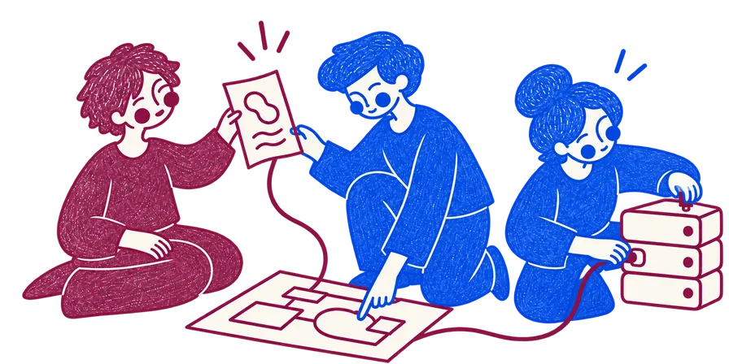

# AG Systems

**Custom software, built from brief to production.**

  <picture>
    <source media="(prefers-color-scheme: dark)" srcset="assets/hero-dark.webp">
    <source media="(prefers-color-scheme: light)" srcset="assets/hero-light.webp">
    
  </picture>

We build custom software, modernize existing systems, and keep them running in production.

We handle architecture, development, cloud infrastructure, and operations, from scoping through launch and handover. We work with companies that need senior engineering without building an internal team first.

[Website](https://agsystems.dev/) · [Client work](https://agsystems.dev/work/) · [Send a project brief](https://agsystems.dev/contact/)
